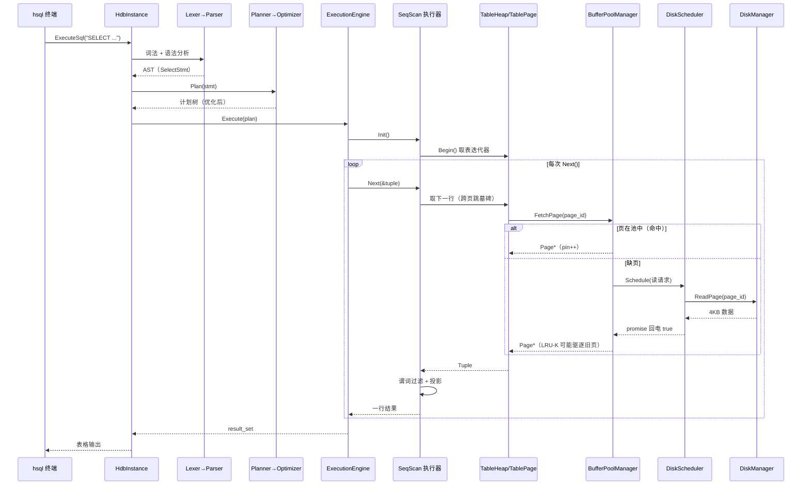

# HDB 整体架构

> 本文档给出 HDB 的模块分层与调用链总览，适合开课串讲或开始实验前通读。

## 分层总览

```
┌─────────────────────────────────────────────────────────┐
│  hsql（交互式终端）/ hdb-sqllogictest（端到端测试） │  tools/
├─────────────────────────────────────────────────────────┤
│  SQL 前端：Lexer → Parser → AST                          │  sql/
│  Binder（绑定 Catalog）→ Planner（计划树）→ Optimizer    │  catalog/ optimizer/
├─────────────────────────────────────────────────────────┤
│  执行引擎：12 个 Volcano 模型执行器 + 表达式求值         │  execution/
├─────────────────────────────────────────────────────────┤
│  表存储：TableHeap / TablePage / Tuple / Schema          │  storage/table/
│  索引：B+Tree（Header/Internal/Leaf 页面）+ 迭代器       │  storage/index/
├─────────────────────────────────────────────────────────┤
│  缓冲池：BufferPoolManager + LRU-K 替换器 + PageGuard    │  buffer/
├─────────────────────────────────────────────────────────┤
│  磁盘调度：DiskScheduler（后台线程 + 请求队列）           │  storage/disk/
│  磁盘管理：DiskManager（文件读写，框架给定）              │
├─────────────────────────────────────────────────────────┤
│  并发控制：LockManager（2PL）+ TransactionManager        │  concurrency/
└─────────────────────────────────────────────────────────┘
```

## 模块与 Lab 对应关系

| 模块 | Lab | 说明 |
|---|---|---|
| `common/` | 全部 | 类型别名、页面大小常量、RID、异常、位图、Channel |
| `primer/` | Lab0 | 并发 Trie（C++ 热身） |
| `type/` | — | Value/TypeId 类型系统（给定） |
| `storage/disk/` | Lab1 | DiskManager（给定）、DiskScheduler（填空） |
| `buffer/` | Lab1 | BufferPoolManager、LRUKReplacer（填空） |
| `storage/page/ table/` | Lab2 | Page、PageGuard、TablePage、Tuple、TableHeap |
| `storage/index/` | Lab3 | B+ 树索引 |
| `sql/ catalog/ optimizer/` | Lab4 | SQL 前端与查询计划 |
| `execution/` | Lab4 | 火山模型执行器 |
| `concurrency/` | Lab5 | 2PL 事务 |

## 调用链（一次 SELECT 的旅程）

```
"hdb> SELECT name FROM student WHERE id > 3;"
  1. Lexer     切分成 Token 流
  2. Parser    递归下降构建 SelectStmt(AST)
  3. Binder    把 student/name/id 绑定到 Catalog 中的表与列
  4. Planner   生成 SeqScan(filter: id>3) 计划树
  5. Optimizer 若存在 id 上的索引则改写为 IndexScan
  6. Executor  SeqScan 迭代拉取元组：
       TableHeap → TablePage → BufferPoolManager
       （缺页时经 DiskScheduler 从 DiskManager 读入）
  7. 结果逐行打印到终端
```

## 时序图（自顶向下穿过全部七层）



调试时先定位自己在哪一层：SQL 报错看 Lexer/Parser；结果不对看执行器与
计划树（EXPLAIN）；数据丢失看 TablePage/BPM；性能问题看索引与替换器。
